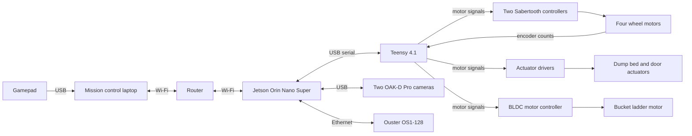
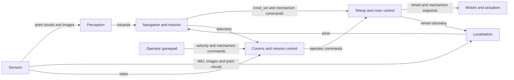

# System design

This page explains what INNEX-1 does and how its parts fit together. Each subsystem has its own page, linked in the [subsystem table](#subsystems).

## A run

The judges place the rover in the start zone at a random position and heading. The rover crosses the obstacle zone, digs sand in the excavation zone, returns, and dumps the sand on the berm in the construction zone. A run lasts 20 minutes, and the team repeats the cycle as many times as it can.

The operator drives the rover with a gamepad (teleop). For the autonomy tasks, the rover runs hands-free and the operator only watches. [rules.md](rules.md#scoring) explains how the judges score a run.

If commands stop arriving, the rover stops by itself. [Teleop and rover control](system/teleop-and-control.md) explains how.

## What gets built first

Teleop comes first: you drive, dig and dump by remote control. Autonomous excavation and dump come next, then autonomous travel. Full autonomy needs all three, so it comes after them.

## Hardware

| Part | Role | Where it sits |
|---|---|---|
| Mission control laptop | Reads the gamepad and runs Foxglove, the dashboard that shows video and telemetry | Mission control |
| Router | Dual-band Wi-Fi link between mission control and the rover | Open question. See [Comms and mission control](system/comms.md#open-questions). |
| Jetson Orin Nano Super | The rover's computer. Runs ROS 2 Jazzy on JetPack 7.2.1 in 25 W mode. See [jetson.md](jetson.md). | On the rover |
| Teensy 4.1 | Microcontroller on USB serial to the Jetson. Handles timing-sensitive input and output: motor controller signals, encoder counting, and stopping outputs when commands stop. | On the rover |
| Four Gimson GR-WM4 worm gear motors | Skid-steer drive. Each has a Hall-effect quadrature encoder. | Wheels |
| Two Sabertooth 2x32 motor controllers | Drive the four wheel motors. The Teensy commands them. | On the rover |
| Bucket ladder with a StepperOnline 24 V geared brushless DC (BLDC) motor | Excavation. The ladder lowers into the sand and raises again. | Front of the rover |
| Dump bed with a door, moved by 24 V linear actuators on Cytron MD10C or MDD10A motor drivers | Deposition | On the rover |
| Two Luxonis OAK-D Pro cameras, front and rear | Active stereo depth, colour video, on-camera H.264 video encoding, and a built-in inertial measurement unit (IMU) | Front and rear of the rover |
| Ouster OS1-128 LiDAR (light detection and ranging) | 360 degree 3D point cloud and reflectivity, with a built-in IMU | On the rover |
| Latching E-stop and an energy logger | The rules require both. See [E-stop](rules.md#e-stop) and [energy logging](rules.md#energy-logging). | On the rover |
| LiPo batteries | Power. See [batteries](rules.md#batteries). | On the rover |

## How the parts connect

## How the subsystems work together

The sensors feed perception and localisation. Navigation and mission combines the hazards and the pose to decide where to go. Its commands reach the command path in teleop and rover control. The gamepad's commands cross the link through comms, which carries them to the command path and carries video and telemetry back. Control gives wheel odometry to localisation.

## Subsystems

| Page | What it answers |
|---|---|
| [Teleop and rover control](system/teleop-and-control.md) | How does a command become wheel or mechanism motion, and how does the rover stop? |
| [Comms and mission control](system/comms.md) | How does the operator see and drive the rover over the link? |
| [Sensors](system/sensors.md) | What does each sensor measure, where does it sit, and what does it publish? |
| [Perception](system/perception.md) | What is around the rover, and where can't it drive? |
| [Localisation](system/localisation.md) | Where is the rover in the arena? |
| [Navigation and mission](system/navigation-and-mission.md) | Where does the rover go next, how does it get there, and what does it do on arrival? |
| [Robot model and simulation](system/simulation.md) | How do we test all of the above without the rover? |

The [glossary](glossary.md) defines the terms these pages use.

## Rules that shape the design

- You can't use the arena walls for mapping, navigation or collision avoidance, and you must prove you don't. See [Navigation and sensing](rules.md#navigation-and-sensing).
- GPS and compass data are not allowed. You can use only the gyroscope and accelerometer of an IMU. See [Not allowed](rules.md#not-allowed).
- The link must average 4,000 kbps or less. See [Communications](rules.md#communications).
- Each arena camera you use costs points. See [Scoring](rules.md#scoring).
- During a hands-free attempt, you can't send commands, orientation data or obstacle locations to the rover. See [Hands-free rules](rules.md#hands-free-rules).
- One push of the E-stop disconnects the batteries from all controllers. See [E-stop](rules.md#e-stop).
- Two of the scores divide berm volume per minute, one by the rover's mass and one by the energy it uses, so a light, efficient rover scores higher. See [Scoring](rules.md#scoring).

## Frames

A frame is a coordinate system attached to something. The names follow [REP 103](https://www.ros.org/reps/rep-0103.html) and [REP 105](https://www.ros.org/reps/rep-0105.html): `map`, `odom` and `base_link`. `base_link` sits on the ground midway between the wheels, with x forward, y left and z up. The [`innex_description` README](../src/innex_description/README.md#frames) describes it.

The arena frame has its origin at the south-west interior corner of the arena. The [`innex_sim` README](../src/innex_sim/README.md#arena-frame) defines it and lists the zone positions.

## How these pages work

Each subsystem page ends with open questions. When the team answers one, the answer goes into the page and the question is removed.
