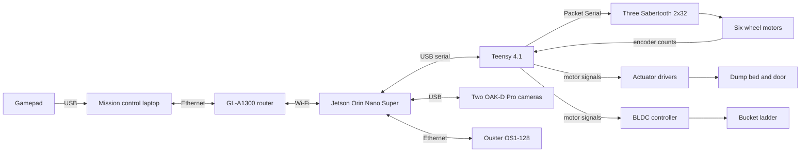
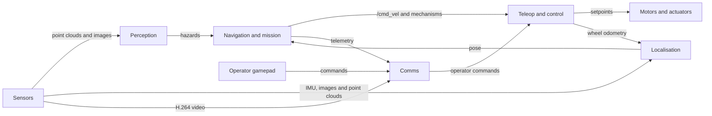

# System design

INNEX-1 digs sand in the excavation zone, carries it across an obstacle-filled arena and dumps it onto a berm in the construction zone. A run lasts up to 20 minutes, and the team ends the run when it chooses. Every part of the hardware and software exists to complete those cycles reliably, safely and with low mass and energy use.

## Run overview

Right before the timer starts, the judges place the rover at a random spot inside the start zone and spin a direction wheel so its forward arrow points north, east, south or west. One cycle has four steps: cross the obstacle zone around random boulders and craters, lower the bucket ladder to collect sand in the excavation zone, return across the obstacle zone to the construction zone, and dump the load onto the berm target area.

In remote control (**teleop**), an operator sits outside the arena in mission control and drives the rover with a gamepad using live video from the rover's cameras. During autonomous attempts, the rover drives itself while the operator watches read-only telemetry without touching any controls.

Whenever commands stop arriving, the rover stops across three independent safety layers. [Teleop and rover control](system/teleop-and-control.md) explains how commands reach the motors and how each stop layer catches a different failure. [Scoring](rules.md#scoring) explains how berm volume, mass, energy, cameras and autonomy determine the competition score.

## Hardware

| Part | Role | Location |
| --- | --- | --- |
| Mission control laptop | Reads the wired gamepad and runs Foxglove for live video and telemetry | Mission control |
| GL.iNet GL-A1300 router | Dual-band Wi-Fi link between mission control (over arena Ethernet) and the rover; corner placement is provisional per [Organiser clarifications](rules.md#organiser-clarifications-provisional). See [Jetson](jetson.md#rover-router). | Arena corner (provisional) |
| Jetson Orin Nano Super | Main onboard computer running ROS 2 Jazzy on JetPack 7.2.1 in 25 W mode. See [Jetson](jetson.md). | On the rover |
| Teensy 4.1 | Microcontroller connected to the Jetson over USB serial; handles motor signals, encoder counting and the 250 ms hardware watchdog | On the rover |
| Six Gimson GR-WM4 worm gear motors | Six-wheel skid-steer drive, each fitted with a Hall-effect quadrature encoder | Wheels |
| Three Sabertooth 2x32 motor controllers | Drive the six wheel motors from Teensy Packet Serial signals | On the rover |
| Bucket ladder with 24 V geared BLDC motor | Lowers into the sand, collects regolith and raises clear | Front of the rover |
| Dump bed and door with 24 V linear actuators | Empties collected sand onto the berm | Rear of the rover |
| Two Luxonis OAK-D Pro cameras | Front and rear active stereo depth, colour video, hardware H.264 encoding and built-in IMU | Front and rear |
| Ouster OS1-128 LiDAR | 360-degree 3D point cloud, surface reflectivity and 6-axis IMU | On the rover |
| Latching E-stop and energy logger | Cuts battery power to all controllers and active subsystems, and records total energy. See [E-stop](rules.md#e-stop). | On the rover |
| LiPo batteries | Drive, mechanism and compute power | On the rover |

## Hardware connections

The following diagram shows the physical connections from the operator's gamepad to the six wheel motors, bucket ladder and dump actuators.

Notice the division of work between `Jetson Orin Nano Super` and `Teensy 4.1`. The Jetson processes camera streams, LiDAR scans, route planning and network video, while the Teensy sits directly ahead of the motor controllers so a Linux freeze or ROS crash still disables motor outputs in hardware within 250 ms.

## Subsystem loop

The software divides into seven subsystems that pass data in a loop, shown in the next diagram.

Follow the loop from left to right. [Sensors](system/sensors.md) converts the physical environment into images, point clouds and inertial readings. [Perception](system/perception.md) uses those scans to mark boulders, craters and walls, while [Localisation](system/localisation.md) combines wheel odometry, the IMU, LiDAR scans and the beacon to estimate where the rover sits. [Navigation and mission](system/navigation-and-mission.md) combines the pose and hazard map to follow a safe route and sequence digging and dumping. Its commands enter [Teleop and rover control](system/teleop-and-control.md), where a command selector chooses between autonomy and the gamepad arriving through [Comms and mission control](system/comms.md). Comms returns compressed camera video and read-only telemetry to mission control.

## Subsystems

| Subsystem | Question it answers |
| --- | --- |
| [Teleop and rover control](system/teleop-and-control.md) | How does a command become wheel or mechanism motion, and how does the rover stop safely? |
| [Comms and mission control](system/comms.md) | How does the operator see and drive the rover within the 4,000 kbps limit? |
| [Sensors](system/sensors.md) | What does each sensor measure, where does it sit and how does it publish data? |
| [Perception](system/perception.md) | What boulders, craters and walls surround the rover? |
| [Localisation](system/localisation.md) | Where is the rover in the arena, and how uncertain is that estimate? |
| [Navigation and mission](system/navigation-and-mission.md) | Where does the rover go next, and what does it do when it arrives? |
| [Robot model and simulation](system/simulation.md) | How do you test the software without the physical rover? |

## Design constraints

Seven competition rules shape the architecture across every subsystem:

- No hard-coded arena dimensions, and provisional wall sensing: the 2027 draft rulebook forbids using arena walls, while the organisers' 4 November email states that mapping the walls live as obstacles for autonomy and navigation is expected to be allowed in the final rulebook provided arena dimensions are not hard-coded. See [Navigation and sensing](rules.md#navigation-and-sensing) and [Organiser clarifications](rules.md#organiser-clarifications-provisional).
- No GPS and no compasses: software reads gyroscope and accelerometer data only, and any magnetometer is switched off or ignored. See [Not allowed](rules.md#not-allowed).
- 4,000 kbps average link limit: raw LiDAR point clouds stay on the Jetson, and cameras compress operator video to H.264 in hardware. See [Communications](rules.md#communications).
- Onboard cameras earn points: using zero arena cameras scores 120 points, so front and rear OAK-D Pro feeds provide all operator views. See [Scoring](rules.md#scoring).
- Hands-free autonomy: during an autonomous attempt, nobody in mission control touches controls or sends orientation data or obstacle positions to the rover. See [Hands-free rules](rules.md#hands-free-rules).
- Hardware E-stop isolation: one push disconnects batteries from all controllers and active subsystems, and resetting the button must never restart motion on its own. See [E-stop](rules.md#e-stop).
- Mass, energy and time in the denominator: berm scores divide volume per minute by rover mass and by total energy used, rewarding low mass, low compute power and short cycle times. See [Scoring](rules.md#scoring).

## Frames

A **frame** is a 3D coordinate system attached to a physical object or place. Every distance, obstacle coordinate or velocity needs a frame to have meaning. INNEX-1 follows [REP 103](https://www.ros.org/reps/rep-0103.html) (metres, radians, x forward, y left, z up) and [REP 105](https://www.ros.org/reps/rep-0105.html) (`map`, `odom` and `base_link`).

`base_link` sits on the ground directly beneath the middle axle and moves with the rover; [`innex_description`](../src/innex_description/README.md#frames) defines its six-wheel geometry and sensor offsets. The arena frame (`map`) has its origin at the south-west interior corner of the pit at sand level; [`innex_sim`](../src/innex_sim/README.md#arena-frame) defines the zone coordinates used in simulation. [Localisation](system/localisation.md) explains why ROS 2 places `odom` between `map` and `base_link`.
