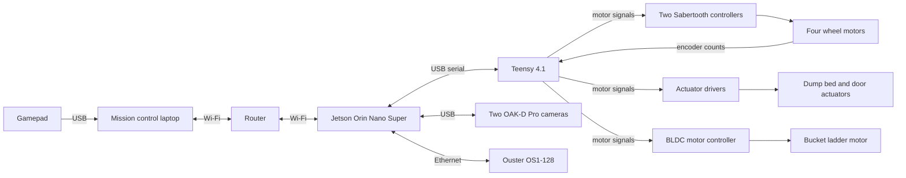
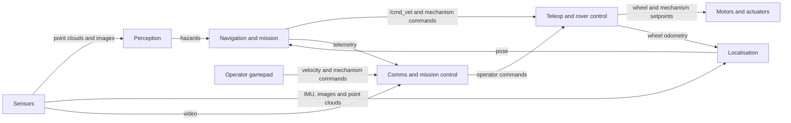

# System design

INNEX-1 digs sand in the excavation zone, carries it to the construction zone and dumps it on the berm. A run lasts 20 minutes. The team repeats the cycle as often as it can.

## A run

The judges place the rover at a random position and heading in the start zone. The rover crosses the obstacle zone, digs in the excavation zone, returns, and dumps sand on the berm in the construction zone.

An operator drives the rover with a gamepad. This is teleop. For the autonomy tasks, the rover drives itself, and the operator only watches telemetry.

If commands stop arriving, the rover stops. [Teleop and rover control](system/teleop-and-control.md) explains how.

[Scoring](rules.md#scoring) explains how the judges score a run.

## Hardware

| Part | Role | Location |
|---|---|---|
| Mission control laptop | Reads the gamepad and runs Foxglove, the dashboard for video and telemetry | Mission control |
| Router | Dual-band Wi-Fi link between mission control and the rover. The choice is open. See [Comms](system/comms.md). | Open question |
| Jetson Orin Nano Super | The rover's computer. Runs ROS 2 Jazzy on JetPack 7.2.1. See [Jetson](jetson.md). | On the rover |
| Teensy 4.1 | Microcontroller on USB serial to the Jetson. Handles timing-sensitive input and output: motor controller signals, encoder counts, and stopping outputs when commands stop. | On the rover |
| Four Gimson GR-WM4 worm gear motors | Skid-steer drive. Each has a Hall-effect quadrature encoder. | Wheels |
| Two Sabertooth 2x32 motor controllers | Drive the four wheel motors. The Teensy commands them. | On the rover |
| Bucket ladder with a StepperOnline 24 V geared brushless DC (BLDC) motor | Excavation. The ladder lowers into the sand and raises again. | Front of the rover |
| Dump bed and door, with 24 V linear actuators on Cytron MD10C or MDD10A drivers | Deposition | On the rover |
| Two Luxonis OAK-D Pro cameras | Front and rear. Active stereo depth, colour video, on-camera H.264 encoding, and a built-in IMU. | Front and rear |
| Ouster OS1-128 LiDAR | 360-degree 3D point cloud and reflectivity, with a built-in IMU | On the rover |
| Latching E-stop and energy logger | Required by the rules. See [E-stop](rules.md#e-stop). | On the rover |
| LiPo batteries | Power | On the rover |

## How the parts connect

## How the subsystems work together

Sensors feed perception and localisation. Navigation and mission combine the hazards and the pose to choose where to go. Its commands reach teleop and rover control. Comms carries the gamepad's commands to the rover, and it carries video and telemetry back. Control sends wheel odometry to localisation.

## Subsystems

| Subsystem | What it answers |
|---|---|
| [Teleop and rover control](system/teleop-and-control.md) | How does a command become wheel or mechanism motion? How does the rover stop? |
| [Comms and mission control](system/comms.md) | How does the operator see and drive the rover over the link? |
| [Sensors](system/sensors.md) | What does each sensor measure, where does it sit, and what does it publish? |
| [Perception](system/perception.md) | What is around the rover, and where can it not drive? |
| [Localisation](system/localisation.md) | Where is the rover in the arena? |
| [Navigation and mission](system/navigation-and-mission.md) | Where does the rover go next, and what does it do on arrival? |
| [Simulation and robot model](system/simulation.md) | How do we test the other subsystems without the rover? |

## Rules that shape the design

- The rover cannot use the arena walls for mapping, navigation or collision avoidance. You must prove it to the judges. See [Navigation and sensing](rules.md#navigation-and-sensing).
- GPS and compasses are not allowed. Use only the gyroscope and accelerometer of the IMU. See [Not allowed](rules.md#not-allowed).
- The link must average 4,000 kbps or less. See [Communications](rules.md#communications).
- Each arena camera you use costs points. See [Scoring](rules.md#scoring).
- During a hands-free attempt, you cannot send commands, orientation data or obstacle locations to the rover. See [Hands-free rules](rules.md#hands-free-rules).
- One push of the E-stop disconnects the batteries from all controllers. See [E-stop](rules.md#e-stop).
- Two scores divide berm volume per minute. One divides by the rover's mass, and the other divides by the energy it uses. A light, efficient rover scores higher. See [Scoring](rules.md#scoring).

## Frames

A frame is a coordinate system attached to something. The repo uses the names in [REP 103](https://www.ros.org/reps/rep-0103.html) and [REP 105](https://www.ros.org/reps/rep-0105.html): `map`, `odom` and `base_link`. `base_link` sits on the ground midway between the wheels, with x forward, y left and z up. The [innex_description README](../src/innex_description/README.md#frames) gives the details.

The arena frame has its origin at the south-west inside corner of the arena. The [innex_sim README](../src/innex_sim/README.md#arena-frame) defines it and lists the zone positions.
