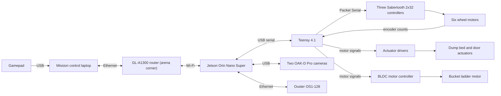
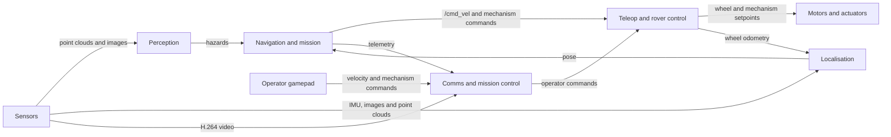

# System design

INNEX-1 digs sand in the excavation zone, carries it across an obstacle-filled arena and dumps it onto a berm in the construction zone. A run lasts up to 20 minutes, and the team ends the run when it chooses. Every part of the hardware and software exists to complete those cycles reliably, safely and with as little mass and energy as possible.

## How a run works

Right before the timer starts, the judges place the rover at a random spot inside the start zone and spin a direction wheel so its forward arrow points north, east, south or west. From there, one cycle has four stages: cross the obstacle zone around random boulders and craters, lower the bucket ladder to collect sand in the excavation zone, cross back to the construction zone, and dump the load onto the berm target area.

In remote control (called **teleop**), an operator sits outside the arena in mission control and drives the rover with a gamepad using live video from the rover's own cameras. During autonomy attempts, the rover drives itself while the operator watches read-only telemetry without touching any controls.

Whenever commands stop arriving, the rover stops itself across three independent safety layers. [Teleop and rover control](system/teleop-and-control.md) traces how commands reach the motors and how each stop layer catches a different failure. [Scoring](rules.md#scoring) breaks down how berm volume, mass, energy, cameras and autonomy add up to the competition score.

## Hardware

| Part | Role | Location |
| --- | --- | --- |
| Mission control laptop | Reads the wired gamepad and runs Foxglove for live video and telemetry | Mission control |
| GL.iNet GL-A1300 dual-band router | Connects mission control (over arena Ethernet) to the rover's Wi-Fi client; corner placement is provisional per [Organiser clarifications](rules.md#organiser-clarifications-provisional). See [Jetson](jetson.md#rover-router) and [Comms](system/comms.md). | Arena corner (provisional) |
| Jetson Orin Nano Super | Main onboard computer running ROS 2 Jazzy on JetPack 7.2.1 in 25 W mode. See [Jetson](jetson.md). | On the rover |
| Teensy 4.1 | Microcontroller over USB serial from the Jetson; owns timing-critical I/O, motor controller signals, encoder pulse counting and the 250 ms hardware watchdog | On the rover |
| Six Gimson GR-WM4 worm gear motors | Six-wheel skid-steer drive, each fitted with a Hall-effect quadrature encoder | Wheels |
| Three Sabertooth 2x32 motor controllers | Drive the six wheel motors from Teensy Packet Serial signals | On the rover |
| Bucket ladder with a StepperOnline 24 V geared BLDC motor | Excavation; lowers into the sand, digs and raises clear | Front of the rover |
| Dump bed and door with 24 V linear actuators | Deposition; driven via Cytron MD10C or MDD10A drivers (final controller choice open) | Rear of the rover |
| Two Luxonis OAK-D Pro cameras | Front and rear active stereo depth, colour video, hardware H.264 encoding and built-in IMU | Front and rear |
| Ouster OS1-128 LiDAR | 360-degree 3D point cloud, surface reflectivity and 6-axis IMU on a raised central platform | On the rover |
| Latching E-stop and energy logger | Required by the rules to cut battery power and log total energy. See [E-stop](rules.md#e-stop). | On the rover |
| LiPo batteries | Main drive, mechanism and compute power | On the rover |

## How the parts connect

The following diagram traces the physical links from the operator's gamepad to the six wheel motors, bucket ladder and dump actuators.

Look at the split between `Jetson Orin Nano Super` and `Teensy 4.1` in the centre of the diagram. The Jetson handles heavy sensor streams, autonomy and network video, while the Teensy sits directly in front of the motor controllers so a Linux freeze or ROS node crash still shuts motor outputs off in hardware within 250 ms.

## How the subsystems work together

The software divides into seven subsystems that pass data in a closed loop, shown in the next diagram.

Follow the loop from left to right. [Sensors](system/sensors.md) turns the physical arena into images, point clouds and inertial readings. [Perception](system/perception.md) uses those scans to mark rocks, craters and walls, while [Localisation](system/localisation.md) combines wheel odometry, the IMU, LiDAR scans and the beacon to track where the rover sits. [Navigation and mission](system/navigation-and-mission.md) combines the pose and hazard map to choose a safe route and run dig and dump sequences. Its commands go into [Teleop and rover control](system/teleop-and-control.md), where a command selector arbitrates between autonomy and the gamepad arriving through [Comms and mission control](system/comms.md). Comms carries compressed camera video and read-only telemetry back to mission control so the operator can drive or supervise.

## Subsystems and codebase status

Stage 1 packages (simulation, robot model, gamepad teleop, drive bridge, Teensy watchdog core and H.264 camera streaming) live on `main` today; perception, localisation and autonomous navigation are in design for Stages 2 and 3.

| Subsystem | Question it answers | Packages on `main` |
| --- | --- | --- |
| [Teleop and rover control](system/teleop-and-control.md) | How does a command become wheel or mechanism motion, and how does the rover stop safely? | [`innex_teleop`](../src/innex_teleop/README.md), [`innex_drive_bridge`](../src/innex_drive_bridge/README.md), [`teensy_drive`](../firmware/teensy_drive/README.md) |
| [Comms and mission control](system/comms.md) | How does the operator see and drive the rover inside the 4,000 kbps budget? | [`innex_video`](../src/innex_video/README.md), `foxglove_bridge` |
| [Sensors](system/sensors.md) | What does each sensor measure, where does it sit and how does it publish data? | [`innex_video`](../src/innex_video/README.md), [`innex_description`](../src/innex_description/README.md) |
| [Perception](system/perception.md) | What obstacles, craters and walls surround the rover? | Planned (Stage 3) |
| [Localisation](system/localisation.md) | Where is the rover in the arena, and how uncertain is that estimate? | Planned (Stage 2) |
| [Navigation and mission](system/navigation-and-mission.md) | Where does the rover go next, and what does it do when it arrives? | Planned (Stages 2 and 3) |
| [Simulation and robot model](system/simulation.md) | How do you test the other subsystems without the physical rover? | [`innex_sim`](../src/innex_sim/README.md), [`innex_description`](../src/innex_description/README.md) |

## Rules that shape the design

Seven competition constraints drive choices across every subsystem:

- No hard-coded arena dimensions, and provisional wall sensing: the 2027 draft rulebook forbids using arena walls, while the organisers' 4 November email states that mapping the walls live as obstacles for autonomy and navigation is expected to be allowed in the final rulebook as long as you do not hard-code arena dimensions. See [Navigation and sensing](rules.md#navigation-and-sensing) and [Organiser clarifications](rules.md#organiser-clarifications-provisional).
- No GPS and no compasses: software can read gyroscope and accelerometer data only, and any magnetometer must be switched off or ignored. See [Not allowed](rules.md#not-allowed).
- 4,000 kbps average link cap: raw LiDAR point clouds stay onboard the Jetson, and cameras compress operator video to H.264 in hardware. See [Communications](rules.md#communications).
- Onboard cameras earn points: using neither arena camera scores 120 points, so front and rear OAK-D Pro feeds give the operator full visibility. See [Scoring](rules.md#scoring).
- Strict hands-free autonomy: during an autonomous attempt, nobody in mission control touches controls or sends orientation data or obstacle positions to the rover. See [Hands-free rules](rules.md#hands-free-rules).
- Hardware E-stop isolation: one push disconnects batteries from all controllers and active subsystems, and resetting the button must never restart motion on its own. See [E-stop](rules.md#e-stop).
- Mass, energy and time sit in the scoring denominator: berm scores divide volume per minute by rover mass and by total energy, favouring light hardware, low compute power and fast cycles. See [Scoring](rules.md#scoring).

## Frames

A **frame** is a 3D coordinate system attached to a physical object or place. Every distance, obstacle point or velocity only makes sense once you know which frame it is measured in. INNEX-1 follows [REP 103](https://www.ros.org/reps/rep-0103.html) (metres, radians, x forward, y left, z up) and [REP 105](https://www.ros.org/reps/rep-0105.html) (`map`, `odom` and `base_link`).

`base_link` sits on the ground directly beneath the middle axle and moves with the rover; [`innex_description`](../src/innex_description/README.md#frames) defines its six-wheel geometry (`58.5 kg` empty mass from the November 2026 INNEX-2 CAD) and sensor offsets. The arena frame (`map`) has its origin at the south-west interior corner of the pit at sand level; [`innex_sim`](../src/innex_sim/README.md#arena-frame) defines the zone coordinates used for simulation tests. [Localisation](system/localisation.md) explains why ROS 2 inserts `odom` between `map` and `base_link`.
