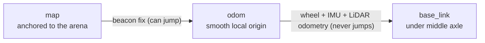
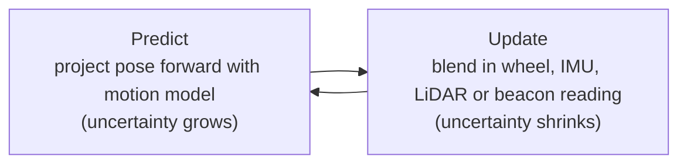

# Localisation

Before the rover can steer around a boulder or reverse cleanly up to the berm, its software needs two facts: where the rover sits on the arena floor and which way it faces. Together, that position and heading are the rover's **pose**. Localisation estimates the pose by combining wheel motion, inertial measurements, LiDAR scans and the beacon on the arena frame, alongside a measure of how uncertain that estimate is.

Localisation is planned for Stage 2 and has no standalone package on `main`; in simulation, [`innex_sim`](../../src/innex_sim/README.md) publishes relative wheel odometry (`/odom` and `odom -> base_link`), `/ouster/points` and an AprilTag beacon model in the start corner. [Navigation and mission](navigation-and-mission.md) uses the pose to plan and track routes, while [Perception](perception.md) uses it to pin detected rocks and craters onto the arena floor.

## Starting from an unknown pose

Right before the 20-minute timer starts, the judges place the rover somewhere inside the `2 m x 2 m` start zone and spin a direction wheel so its forward arrow points north, east, south or west. Because the arena sits indoors and the rules ban GPS and compasses, the rover starts with zero knowledge of its coordinates or cardinal heading in the pit.

Before announcing hands-free for travel or full autonomy, the operator can drive the rover inside the start zone by remote control to establish its pose. The beacon mounts on the arena frame near the start zone, facing the construction zone, so a rover placed facing away from that corner will not see the beacon with its front camera at spawn (though the rear camera might). Turning the rover inside the start zone brings the beacon into view and locks down the starting pose before autonomy takes over.

## What each sensor tells you, and where it goes wrong

No single sensor on INNEX-1 can track the pose reliably across a 20-minute run on sand. Each source makes up for a weakness in the others, so it helps to build localisation in layers and understand what each layer measures and how it breaks.

### Wheel odometry on sand

Picture walking across a dark room while counting your footsteps. If you know the length of one stride, multiplying stride length by step count tells you how far you walked. On the rover, quadrature encoders on the six wheel motors count rotations, and multiplying those counts by the tyre circumference gives distance travelled. Summing small motions over time like this is called **odometry**.

On loose regolith, counting wheel turns misleads you. Paddle tyres sink and spin, so the rover advances less than the encoders report. Because INNEX-1 is a six-wheel skid-steer rover, turning forces the front and rear axles to drag sideways across the sand. That lateral scrub makes turning the single biggest source of wheel-odometry error. Worse, the encoders only see shaft rotation and cannot tell when a tyre slips, so every turn bakes error permanently into the estimate.

### Heading change from the IMU

Because tyre slip ruins wheel-based turn estimates, you need a rotation sensor that ignores the ground altogether. Inside an inertial measurement unit (IMU), a **gyroscope** measures angular velocity around the rover's body axes. Integrating yaw rate over time tells you how far the rover has turned since the last tick, regardless of how badly the wheels slipped.

The gyroscope still has two limits. First, every MEMS gyroscope carries a tiny bias offset in its zero reading, so integrated heading drifts slowly over minutes. Second, without a compass, the IMU has no reference to the arena walls or magnetic north: it knows the rover turned `30 degrees` left from where it started, never whether it started facing east or south.

Hardware choice matters here at inspection. The Ouster OS1-128 contains a 6-axis IMU with no magnetometer hardware at all, whereas Luxonis OAK-D Pro units commonly carry a 9-axis BNO086 with a magnetometer. Feeding localisation from the Ouster's 6-axis IMU avoids having to strip compass channels in software.

### Tracking motion with LiDAR and the arena walls

Wheel odometry and the gyroscope both degrade when the rover digs, climbs uneven berms or scrubs in soft sand. Sensing the arena walls with the Ouster OS1-128 changes what localisation can track across the entire pit.

Imagine printing two transparent top-down sheets of the LiDAR scan: one captured `100 ms` ago, and one captured right at this instant. Because the rover moved between scans, the dots along the pit walls shifted by a few centimetres. If you slide and rotate the second sheet until its wall lines sit directly on top of the first sheet's wall lines, the shift you applied equals the rover's exact motion over that tenth of a second. Aligning consecutive point clouds like this is called **LiDAR odometry**, and packages solve it with variants of **iterative closest point (ICP)**.

This works cleanly on sand because laser beams bounce off rigid wooden pit walls that never slip while the tyres spin. It also obeys the rule against hard-coded arena dimensions: software never stores `7.9 m x 4.4 m` in code, and instead matches each live scan against the scans it recorded moments earlier.

LiDAR odometry still leaves two geometric gaps. Tiny alignment errors accumulate over long drives, and a rectangular pit looks identical when rotated `180 degrees`, so wall scans alone cannot distinguish the start end from the excavation end. Point-cloud registration also consumes real CPU budget on a Jetson capped at `25 W`.

### Anchoring the arena frame with the beacon

To orient the rover to the real zones and cancel accumulated drift, you need a fixed landmark with a known position and facing direction: the beacon mounted on the frame near the start zone, facing the construction zone.

You place visual or reflective targets of known physical size, called **fiducials**, onto that single flat beacon face. Because an AprilTag detector knows the exact side length of the printed black-and-white square, the tag's apparent pixel size and perspective tilt in an OAK-D image yield the 3D distance and angle from the lens to the beacon. Retroreflective tape on the same face gives the Ouster LiDAR a high-reflectivity target as well.

Camera-based AprilTag fixes lose reach at the far end of the pit: from the middle of the excavation zone, the beacon sits roughly `6.6 m` away at about `71 degrees` off its face normal, where flat tags foreshorten sharply. Pairing LiDAR odometry across the pit with beacon sightings whenever the rover works near the start and construction zones gives you three complementary layers:

1. Wheel encoders and the IMU gyroscope provide high-rate, smooth local motion.
2. The single-face beacon anchors the rover's pose to the arena zones and cancels long-term drift.
3. LiDAR odometry tracks slip-free motion against live sensed walls all the way into the excavation zone.

Each layer functions without layer 3 if the final 2027 rulebook restricts wall sensing, and gains full-pit precision when all three run together.

## Why ROS 2 splits the pose into two frames

Combining continuous odometry with occasional beacon fixes exposes a control hazard. Suppose you keep a single arena coordinate system and publish the rover's pose directly inside it. Imagine the rover drives `3 m` across the obstacle zone, picking up `25 cm` of sideways drift on loose sand. Halfway around a boulder, a camera catches sight of the beacon, and localisation snaps the rover's estimated position `25 cm` sideways in a single tick.

To the path-following controller steering past that boulder, the rover appeared to teleport `25 cm` off its line. The controller reacts to the step jump by jerking the wheels hard, swinging the rover straight into the rock it was clearing. If you suppress jumps by ignoring the beacon instead, the rover steers smoothly while thinking the berm sits `40 cm` away from its real spot.

You need smooth continuity for short-range steering and jump-corrected global accuracy for route planning at the same time. [REP 105](https://www.ros.org/reps/rep-0105.html) achieves both by chaining two world frames above `base_link`, shown in the diagram.



Inspect the two arrows separately. The link from `odom` to `base_link` integrates continuous motion from wheels, IMU and LiDAR odometry: it drifts slowly over minutes and *never* jumps, giving local controllers a smooth pose to steer on. The link from `map` to `odom` absorbs every discrete beacon correction: when a beacon sighting reveals `25 cm` of drift, localisation shifts `map -> odom` by `25 cm`, putting the rover on the true spot on the arena map while `base_link` keeps gliding smoothly inside `odom`.

That split also satisfies a hard rule in ROS 2's transform library (**TF**): every frame has one parent. If an odometry node and a beacon node both broadcast `map -> base_link`, consumers would receive conflicting transforms on alternate ticks. Placing `odom` between them gives each link a single publisher.

## Combining noisy estimates with a Kalman filter

Whenever two sources disagree (say wheel odometry versus a beacon sighting, or wheel speed versus LiDAR odometry), you hold two noisy estimates of the same state. Blending them optimally is the job of a state-estimation filter.

### Why a plain average fails

Splitting the difference looks tempting at first. Suppose the rover drove straight down the pit: wheel odometry reports `x = 2.00 m`, while a beacon fix reports `x = 1.60 m`. Averaging the two puts you at `1.80 m`.

A `50/50` midpoint assumes both sensors deserve equal trust, which fails on sand. After two metres of wheel slip, wheel odometry might easily be off by `30 cm`, whereas a close-range AprilTag fix might be sharp to `10 cm`. Giving a `30 cm` guess equal weight with a `10 cm` measurement drags your pose `20 cm` away from the cleaner reading.

### Measuring uncertainty with variance and covariance

To weight competing sensors fairly, each source reports its typical error spread alongside its value. Squaring the typical error (`1` standard deviation) gives the **variance**:

- Wheel odometry with a `0.30 m` typical error has variance `0.30 * 0.30 = 0.09 m^2`.
- The beacon fix with a `0.10 m` typical error has variance `0.10 * 0.10 = 0.01 m^2`.

Because squaring grows quadratically, three times the error uncertainty produces nine times the variance. Across all 3D pose and velocity variables (`x`, `y`, `z`, roll, pitch, yaw and their rates), those variances sit along the diagonal of a **covariance** matrix, while the off-diagonal cells capture how errors couple together (such as a small yaw error growing into a large sideways `y` error as the rover drives forward).

### Weighting the blend

Given a prediction variance and a measurement variance, you want a blending weight between `0` and `1` that steps almost all the way to a sharp measurement when the prediction is loose, and barely budges when the measurement is noisy. Dividing prediction variance by total variance gives that exact ratio:

```text
weight = prediction variance / (prediction variance + measurement variance)
```

Substitute the wheel prediction (`2.00 m`, variance `0.09`) and the beacon fix (`1.60 m`, variance `0.01`):

```text
weight           = 0.09 / (0.09 + 0.01) = 0.90
updated position = prediction + weight * (measurement - prediction)
                 = 2.00 + 0.90 * (1.60 - 2.00)
                 = 1.64 m
```

Test both extremes to verify the behaviour. If the beacon had zero noise (variance `0`), the weight would equal `0.09 / 0.09 = 1.0`, adopting `1.60 m` outright. If a blurry far-away tag reported huge uncertainty (say variance `9.0`), the weight would drop to `0.09 / 9.09` (under `1` per cent), leaving the prediction nearly untouched. Even better, the fused variance drops to `0.009 m^2`, tighter than either sensor alone.

### Predict, update and the extended Kalman filter

Textbooks call that blending weight the **Kalman gain** (`K`, computed from state covariance `P` and measurement covariance `R`). A **Kalman filter** repeats it in the two-step loop shown in the next diagram.



In **predict**, the filter projects the pose forward on each tick and inflates covariance to reflect fresh slip and drift. In **update**, an incoming reading nudges the pose by its Kalman gain and shrinks covariance.

A linear Kalman filter assumes straight-line equations throughout, which breaks the moment a rover turns: driving forward by `d` at heading `theta` updates `x` by `d * cos(theta)` and `y` by `d * sin(theta)`, and trigonometric functions curve. An **extended Kalman filter (EKF)** linearises those curves with a tangent slope around the rover's pose on every tick. In ROS 2 Jazzy, `robot_localization` provides `ekf_node`: one local instance (`world_frame: odom`) fuses continuous wheel, IMU and LiDAR velocities into `odom -> base_link`, and a second global instance (`world_frame: map`) folds in discrete beacon poses to publish `map -> odom`.

## Five ways localisation fails in practice

Most real-world localisation failures trace back to dishonest inputs instead of filter maths:

- Uncorrected tyre slip: without LiDAR odometry or beacon updates, six-wheel scrub on loose sand steadily stretches `odom` away from reality because wheel encoders see normal shaft rotation.
- Overconfident covariances: if an AprilTag detector or ICP matcher stamps a tiny variance onto a motion-blurred image or a slipped scan, the Kalman gain spikes near `1.0` and yanks the pose to a false spot.
- Clock skew or late timestamps: stamping a camera frame on ROS callback arrival instead of shutter capture pairs the sighting with the wrong point in a turn.
- Unmeasured sensor extrinsics: if the physical camera or LiDAR sits `3 degrees` tilted from its xacro angle, averaging a thousand frames only converges faster onto a biased pose.
- Occluded wall geometry: heavy dust or close-up berm piles can starve ICP of clean planar wall points until the rover backs clear.

## Requirements and competition rules

Subsystem requirements:

- Publish a continuous, jump-free local pose (`odom -> base_link`) for motion control alongside an arena-anchored global pose (`map -> odom`) for planning.
- Recover the rover's arena pose from a randomised start-zone position and cardinal heading (`N`, `E`, `S`, `W`).
- Operate with zero GPS and zero magnetometer/compass inputs, without hard-coding arena dimensions.
- Publish calibrated pose and twist covariances so downstream mission checks know when pose lock is trustworthy.

Applicable rules:

- [Not allowed](../rules.md#not-allowed): no GPS and no compasses.
- [Navigation and sensing](../rules.md#navigation-and-sensing) and [Organiser clarifications](../rules.md#organiser-clarifications-provisional): one beacon allowed near the start zone facing the construction zone (all markers on one flat face); live wall sensing is provisionally expected to be allowed in 2027 so long as arena dimensions are never hard-coded.
- [The run](../rules.md#the-run) and [Autonomy conditions](../rules.md#autonomy-conditions): random start pose and cardinal direction; remote driving inside the start zone is allowed to localise before going hands-free.
- [Hands-free rules](../rules.md#hands-free-rules): no orientation updates or commands from mission control during autonomous attempts.

## Open questions

1. Will the final 2027 rulebook confirm live wall sensing for localisation, and can navigation store zone goal coordinates relative to the beacon frame without violating the ban on hard-coded arena dimensions?
2. Which 3D LiDAR odometry package (such as KISS-ICP, Kinematic-ICP or RKO-LIO) holds low drift across the Moon Yard inside the Jetson's `25 W` envelope?
3. What combination of large/small AprilTags and LiDAR retroreflective strips fits on the single beacon face once official frame dimensions publish?
4. How much yaw and longitudinal slip do the six paddle wheels accumulate across one real sand crossing?

## Further reading

- [REP 103](https://www.ros.org/reps/rep-0103.html) and [REP 105](https://www.ros.org/reps/rep-0105.html)
- [Nav2 Jazzy: smoothing odometry using robot_localization](https://docs.nav2.org/jazzy/configuration_and_development/first_time_robot_setup_guide/odom/setup_robot_localization/)
- [AprilTag library](https://github.com/AprilRobotics/apriltag), [apriltag_ros](https://index.ros.org/p/apriltag_ros/) and [DepthAI AprilTag node](https://docs.luxonis.com/software-v3/depthai/depthai-components/nodes/april_tag/)
- [OAK-D Pro specifications](https://docs.luxonis.com/hardware/products/OAK-D%20Pro)
