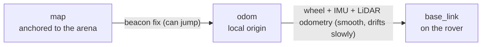
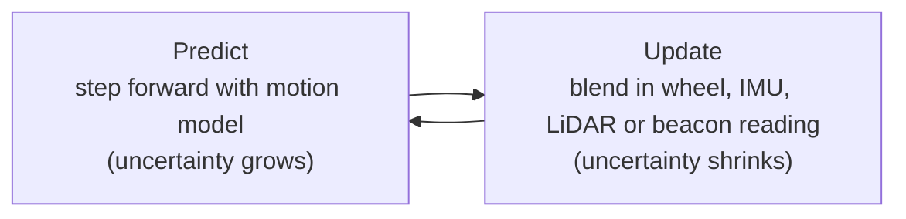

# Localisation

Before the rover can steer around a rock or back up to the berm, its software needs two facts: where the rover sits on the arena floor and which way it faces. Together, that position and heading are the rover's **pose**. Localisation estimates the pose by combining wheel motion, inertial measurements, LiDAR scans and the beacon on the arena frame, along with a measure of how uncertain that estimate is.

[Navigation and mission](navigation-and-mission.md) uses the pose to plan and follow routes across the arena. [Perception](perception.md) uses it to place the rocks and craters it detects onto the arena floor. To build the estimate, localisation takes wheel encoder counts from [Teleop and rover control](teleop-and-control.md), plus IMU data, camera images and LiDAR point clouds from [Sensors](sensors.md).

## Requirements

- Publish a smooth pose that doesn't jump, so motion controllers can steer without sudden corrections.
- Anchor the rover's position and heading to the arena frame without hard-coding the arena's dimensions.
- Recover the rover's pose from a random starting position and one of four starting headings.
- Operate without GPS and without compass data.
- Report how uncertain the pose estimate is.

## Competition rules

- [Not allowed](../rules.md#not-allowed): no GPS and no compass. If an IMU includes a magnetometer, switch its compass output off or strip its data before any node reads it.
- Walls and arena dimensions: the 2027 draft rulebook (v0.1) forbids using the arena walls, while the organisers' email clarification states that sensing and mapping the walls for autonomy and navigation is expected to be allowed in the final rulebook, provided you do not hard-code the arena's dimensions into autonomy software. Until the final rulebook confirms that change, the localisation stack keeps a path that works without wall matching.
- [Navigation and sensing](../rules.md#navigation-and-sensing): you can mount one beacon on the frame near the start zone, facing the construction zone, with any markers placed on one face.
- [The run](../rules.md#the-run): the judges choose a random starting position inside the start zone and spin a direction wheel so the rover's forward arrow points north, east, south or west.
- [Autonomy conditions](../rules.md#autonomy-conditions): for travel and both full autonomy tasks, the operator can drive the rover inside the start zone by remote control to localise before announcing hands-free.
- [Hands-free rules](../rules.md#hands-free-rules): do not send commands, orientation data or obstacle locations to the rover during an autonomous attempt.

## Starting from an unknown pose

Right before the 20-minute timer starts, the judges place the rover somewhere inside the 2 m by 2 m start zone and point its forward arrow north, east, south or west. Because the arena is indoors and the rules ban GPS and compasses, the rover starts with no knowledge of its coordinates in the arena.

Before announcing hands-free for travel or full autonomy, you can drive the rover inside the start zone by remote control to establish its pose. The beacon sits on the frame near the start zone, facing the construction zone, so a rover pointing away from it won't see it at spawn. Turning the rover on the spot inside the start zone brings the beacon into view and locks down the starting pose before autonomy takes over.

## What each sensor tells you, and where it goes wrong

No single sensor on INNEX-1 can track the pose reliably on its own across a full run. Each source makes up for a weakness in the others, so it helps to build localisation in layers and understand what each layer measures and how it breaks.

### Wheel odometry on sand

Think about walking across a dark room while counting your footsteps. If you know the length of one stride, multiplying stride length by step count tells you how far you walked. On the rover, encoders on the wheel motors count rotations, and multiplying those counts by the wheel circumference gives distance. Adding up small motions over time like this is called **odometry**.

On loose sand, counting wheel turns misleads you. The tyres slip and sink, so the rover travels less distance than the encoders claim. Because INNEX-1 is a skid-steer rover, it turns by driving its left and right wheels at different speeds and dragging the tyres sideways across the sand. That sideways drag makes turning the largest source of error. Even in simulation, where wheel slip is mild, the rover turns 3 to 4 per cent less than its wheel odometry reports; on real sand, the gap is far larger. Worse, the encoders can't tell when a tyre slips, so every metre you drive adds error that stays in the estimate for the rest of the run.

### Heading change from the IMU

Because wheel slip ruins turn estimates, you need a way to measure rotation that doesn't depend on tyres gripping the sand. Inside an inertial measurement unit (IMU), a **gyroscope** measures how fast the body rotates around its axes. Adding up those rotation rates over time tells you how far the rover has turned since it started.

The gyroscope ignores wheel slip, which makes heading change the most useful signal you get from the IMU. It still has two limits. First, every gyroscope has a small offset in its zero reading, so the heading estimate drifts over minutes. Second, without a compass, the IMU has no reference to the arena or to magnetic north. It can tell you that the rover turned 30 degrees left from its starting heading, but it can't tell you which direction that starting heading pointed in the arena.

Hardware choice matters here for inspection. The Ouster OS1-128 contains a 6-axis IMU with no magnetometer at all, whereas an OAK-D Pro can carry a 9-axis IMU with a magnetometer depending on the hardware revision. Using the Ouster's IMU avoids having to strip compass data from the localisation pipeline.

### Tracking motion with LiDAR and the arena walls

Wheel odometry and the gyroscope both degrade when the rover digs, climbs over loose sand or twists in place. Sensing the arena walls with the Ouster OS1-128 LiDAR changes what localisation can do across the whole pit.

Imagine printing two transparent copies of the LiDAR's top-down scan: one captured a tenth of a second ago, and one captured at this instant. Because the rover moved slightly between scans, the dots along the arena walls shifted by a few centimetres. If you slide and rotate the second sheet until its wall lines sit right on top of the first sheet's wall lines, the amount you had to move the sheet equals the rover's motion between those two moments. Matching consecutive point clouds like this is called **LiDAR odometry**, and software typically solves the alignment with an algorithm such as **iterative closest point (ICP)**.

This works well on sand for a simple reason: the laser beams bounce off rigid arena walls that never slip, even while the rover's tyres spin in place. It also respects the rule against hard-coded arena dimensions. The software never stores the pit's 7.9 m by 4.4 m size in code; it compares each live scan against the scans it built moments earlier.

LiDAR odometry still leaves two geometric gaps. First, tiny alignment errors add up over long drives, so the pose can still drift over time. Second, a live scan of a rectangular pit only tells you how far you moved from where you started, and a rectangle looks identical if you rotate it 180 degrees. Without an external landmark, the LiDAR can't tell which end of the pit is the excavation zone. Running point-cloud matching also uses real CPU time, so any LiDAR odometry package has to fit inside the Jetson's 25 W power mode.

### Anchoring the arena frame with the beacon

To tell the rover where the arena zones sit and cancel any drift that builds up over a run, you need one fixed reference with a known position and orientation. That reference is the beacon mounted on the frame near the start zone, facing the construction zone.

You place markers on that single face that software can recognise and measure, known as **fiducials**. An AprilTag works for the cameras: because the detector knows the exact physical width of the black-and-white square, the tag's apparent size and tilt in the image give the distance and angle from the camera to the beacon. Retroreflective strips on the same face can give the LiDAR a bright target as well, because the Ouster reports surface reflectivity alongside distance. Working backwards from the beacon defines the arena frame.

Camera-based beacon readings lose reach on the far side of the arena. From the centre of the excavation zone, the beacon sits roughly 6.6 m away at about 71 degrees off its face, where a camera struggles to read a flat AprilTag. With LiDAR odometry tracking motion against the sensed walls, the rover doesn't depend on seeing the beacon from the excavation zone; the beacon anchors the arena frame at the start and whenever the rover returns to the construction end.

Designing localisation in three layers keeps the architecture resilient while the final rulebook is pending:

1. Wheel odometry and the IMU gyroscope provide smooth local motion.
2. The beacon anchors the rover to the arena frame.
3. LiDAR odometry tracks motion against the sensed walls across the entire pit without wheel slip.

Each layer works without the one that follows it, so the rover can still localise with layers 1 and 2 alone if wall rules tighten, while gaining full-arena accuracy once layer 3 runs within the Jetson's compute budget.

## Why ROS 2 splits the pose into two frames

Once you combine continuous odometry (from wheels, IMU and LiDAR) with discrete beacon fixes, an architectural problem turns up. Suppose you keep one coordinate system for the whole arena and publish the rover's pose in it. Imagine the rover drives 3 metres across the obstacle zone, accumulating 25 cm of sideways drift along the way. Halfway around a rock, the camera catches sight of the beacon, and your localisation node snaps the estimated position 25 cm to the right in one tick.

To the motion controller steering around that rock, the rover appeared to teleport 25 cm sideways. The controller reacts to the sudden error by jerking the wheels, which can swing the rover into the rock it was avoiding. If you avoid jumps by ignoring the beacon instead, the rover drives smoothly, except the route planner thinks the berm sits 40 cm away from its real spot.

You need both behaviours at once: smooth, continuous motion for short-range control, and arena-fixed accuracy for route planning. [REP 105](https://www.ros.org/reps/rep-0105.html) solves this by placing two fixed coordinate frames above the rover's body frame, `base_link`, in a chain. The following diagram shows how the three frames connect and where each update lands.



Look at the two links in the chain. The link from `odom` to `base_link` tracks continuous motion from the wheels, IMU and LiDAR odometry. It can drift slightly over time, but it never jumps, so short-range controllers read `base_link` in `odom` and steer without sudden jerks. The link from `map` to `odom` absorbs every discrete correction from the beacon. Whenever a beacon sighting reveals 25 cm of accumulated drift, localisation shifts the `map` to `odom` transform by 25 cm. That puts the rover back in the right spot on the arena map for the route planner, while `base_link` keeps moving smoothly inside `odom`.

In ROS 2, the transform library (**TF**) enforces one strict rule: every frame has one parent. If an odometry node and a beacon node both tried to publish a direct transform from `map` to `base_link`, any node asking for the rover's pose would receive two conflicting answers. Putting `odom` in the middle gives every link a single owner.

## Combining noisy estimates with a Kalman filter

When two sensors disagree (say wheel odometry versus LiDAR odometry, or odometry versus a beacon sighting), you hold two estimates of where the rover sits. Both contain error. Combining them well is the job of a fusion filter.

### Why a plain average fails

Your first instinct might be to split the difference. Suppose the rover drove straight down the arena. Wheel odometry says `x = 2.00 m`, and a beacon sighting (or a LiDAR match) says `x = 1.60 m`. Taking the midpoint puts you at `1.80 m`.

That average assumes both numbers deserve equal trust, which isn't true on sand. After two metres of driving with wheel slip, wheel odometry could be off by 30 cm either way. A crisp close-range beacon sighting might be accurate to around 10 cm. Giving a sloppy wheel guess the same vote as a sharp measurement pulls your estimate 20 cm away from the stronger source.

### Measuring uncertainty with variance and covariance

To weight each source fairly, every sensor has to report both its reading and how spread out its errors tend to be. Statistics captures that spread by squaring the typical error to produce the **variance**. Using the numbers from that example:

- Wheel odometry has a typical error of `0.30 m`, so its variance is `0.30 * 0.30 = 0.09 m^2`.
- The beacon sighting has a typical error of `0.10 m`, so its variance is `0.10 * 0.10 = 0.01 m^2`.

Because squaring grows fast, three times the error becomes nine times the variance. On a real rover, you track several numbers at once (x, y, heading and velocities), so those variances sit in a grid called a **covariance** matrix. The off-diagonal entries record how an error in one value feeds into another, such as a small heading mistake turning into a growing sideways position error as the rover drives forward.

### Weighting the blend

With both variances in hand, you want a blending weight between 0 and 1 that says how far to step from the prediction towards the measurement. When the prediction is uncertain and the measurement is sharp, the weight must sit near 1. When the measurement is noisy and the prediction is tight, the weight must sit near 0. Dividing the prediction variance by the total variance gives that exact ratio:

```text
weight = prediction variance / (prediction variance + measurement variance)
```

Plug in our wheel prediction (`2.00 m`, variance `0.09`) and the beacon sighting (`1.60 m`, variance `0.01`):

```text
weight = 0.09 / (0.09 + 0.01) = 0.90
```

You move 90 per cent of the way from the prediction to the measurement:

```text
updated position = prediction + weight * (measurement - prediction)
                 = 2.00 + 0.90 * (1.60 - 2.00)
                 = 1.64 m
```

Check both extremes to verify that the formula makes sense. If the measurement had zero error (variance `0`), the weight would equal `0.09 / 0.09 = 1`, and you'd take `1.60 m` outright. If the measurement had far more noise (say variance `9.0`), the weight would drop to `0.09 / 9.09`, under 1 per cent, and you'd stay close to the prediction. The combined estimate also has a slightly smaller variance (`0.009 m^2`) than either input alone, because even a rough wheel estimate narrows down the small remaining uncertainty in the sharper reading.

### The predict-and-update loop

That blending weight is called the **Kalman gain** (written `K` in textbooks, alongside `P` for the state covariance and `R` for the measurement covariance). A **Kalman filter** runs this calculation in the following two-step cycle.



In the **predict** step, the filter projects the previous pose forward using the rover's motion model and inputs such as wheel speeds and gyroscope rates. Because every movement on sand adds slip and drift, the filter adds motion uncertainty on every tick, so the state covariance grows between updates.

In the **update** step, a measurement arrives (a gyroscope rate, a LiDAR odometry velocity or a beacon pose). The filter compares that reading with its prediction, computes the Kalman gain from both covariances, nudges the pose towards the measurement and shrinks the state covariance.

### Why rovers use an extended Kalman filter

A plain Kalman filter assumes every step is a straight-line relationship, where doubling an input doubles the output. Rover motion stops being linear as soon as you turn. Driving forward by distance `d` at heading angle `theta` changes `x` by `d * cos(theta)` and `y` by `d * sin(theta)`, and sines and cosines curve.

An **extended Kalman filter (EKF)** handles those curves by approximating them with a straight tangent line at the rover's pose on each tick, then running the same predict-and-update maths. In ROS 2 Jazzy, the `robot_localization` package provides `ekf_node` for this. A standard two-filter setup runs one `ekf_node` with `world_frame` set to `odom`, fusing continuous wheel odometry, IMU and LiDAR odometry velocity to publish `odom` to `base_link`, and a second `ekf_node` with `world_frame` set to `map`, adding discrete beacon poses to publish `map` to `odom`.

You don't have to build the full three-layer EKF before testing anything else. An EKF pays off once the underlying sensors have honest covariances and measured transforms, so you can bring up wheel-plus-IMU odometry and beacon anchoring first, then add LiDAR odometry once its Jetson load is measured.

## How localisation fails

A filter is only as honest as the measurements you feed into it. Most localisation bugs on a rover come from five problems.

When the tyres slip in loose sand, wheel odometry reports motion that didn't happen. Without LiDAR odometry or a beacon sighting to correct it, the estimate drifts further away from the rover's real position because the encoders see normal wheel rotation and can't flag slip on their own.

Overconfident covariances break the update step. Remember how the Kalman gain reacts to a tiny measurement variance: the weight shoots towards 1. If an AprilTag detector or scan matcher reports a tiny covariance on a blurry frame or a poor alignment, the filter treats that bad reading as ground truth and snaps the pose to the wrong spot. The planner then steers towards that false jump.

Bad timestamps scramble motion matching. A filter lines up each measurement with the rover's pose at the instant the sensor captured it. If a camera frame or LiDAR scan carries a late or unsynchronised clock, the filter pairs the sighting with the wrong moment in a turn and blames the wrong motion for the gap.

Bad calibration introduces a bias that filtering never removes. If the URDF places a camera or the LiDAR 5 cm to the left of its real mount on the chassis, or angled two degrees off, every measurement carries that same fixed offset. Averaging a hundred biased sightings produces a confident wrong answer.

Poor LiDAR visibility degrades scan matching. Dust thrown up during digging or a low mount blocked by the chassis removes the clean wall surfaces that ICP needs to lock onto. When too few wall points survive, the matcher can lose alignment or drift fast until the view clears.

## Open questions

1. Will the final 2027 rulebook confirm wall sensing for localisation and navigation, and can the rover store zone coordinates relative to the beacon without breaking the rule against hard-coded arena dimensions?
2. Which LiDAR odometry package (such as Kinematic-ICP, RKO-LIO or KISS-ICP) gives the lowest drift while staying inside the Jetson's 25 W budget?
3. What markers go on the single beacon face: AprilTags for the cameras, retroreflective strips for the LiDAR, or both?
4. What are the final dimensions and exact mounting position of the beacon frame?
5. How far does wheel odometry drift on real sand over one crossing and in a turn?
6. Do the first autonomy targets need a fused EKF, or are wheel-plus-IMU odometry and beacon fixes enough to start with?

## Further reading

- [REP 103](https://www.ros.org/reps/rep-0103.html) and [REP 105](https://www.ros.org/reps/rep-0105.html)
- [Nav2 Jazzy: smoothing odometry using robot_localization](https://docs.nav2.org/jazzy/configuration_and_development/first_time_robot_setup_guide/odom/setup_robot_localization/)
- [AprilTag library](https://github.com/AprilRobotics/apriltag)
- [apriltag_ros](https://index.ros.org/p/apriltag_ros/)
- [DepthAI AprilTag node](https://docs.luxonis.com/software-v3/depthai/depthai-components/nodes/april_tag/)
- [OAK-D Pro specifications](https://docs.luxonis.com/hardware/products/OAK-D%20Pro)
