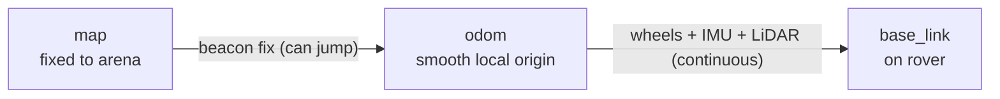
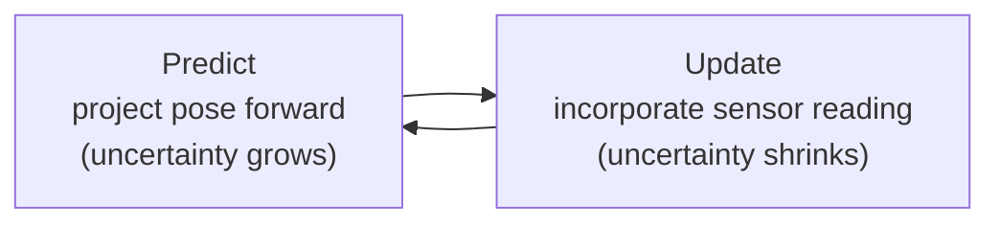

# Localisation

Before the rover can steer around a boulder or back up to the berm, its software needs two facts: where the rover sits on the arena floor and which way it faces. Together, that position and heading are the rover's **pose**. Localisation estimates the pose by combining wheel motion, inertial measurements, LiDAR scans and the beacon on the arena frame, along with a measure of how uncertain that estimate is.

[Navigation and mission](navigation-and-mission.md) uses the pose to plan and follow routes across the arena, and [Perception](perception.md) uses it to place detected boulders and craters onto the arena floor. To compute the estimate, localisation reads wheel encoder counts from [Teleop and rover control](teleop-and-control.md) alongside IMU data, camera images and LiDAR point clouds from [Sensors](sensors.md).

## Starting pose

Right before the 20-minute timer starts, the judges place the rover at a random spot inside the 2 m by 2 m start zone and spin a direction wheel so its forward arrow points north, east, south or west. Because the arena is indoors and the rules ban GPS and compasses, the rover starts with no knowledge of its coordinates or cardinal heading in the pit.

Before announcing hands-free for travel or full autonomy, the operator can drive the rover inside the start zone by remote control to establish its pose. The beacon mounts on the arena frame near the start zone, facing the construction zone, so a rover placed facing away from that corner cannot see the beacon through its front camera at spawn (though the rear camera might). Turning the rover inside the start zone brings the beacon into view and fixes the starting pose before autonomy begins.

## Sensor layers

No single sensor on INNEX-1 tracks the pose reliably across a full run on sand. Each source compensates for a limitation in the others, so localisation combines four inputs in layers.

### Wheel odometry

Imagine walking across a dark room while counting your footsteps. If you know the length of one step, multiplying step length by step count gives the distance walked. On the rover, quadrature encoders on the six wheel motors count shaft rotations, and multiplying those counts by the wheel circumference gives distance travelled. Adding up small motions over time like this is called **odometry**.

On loose sand, counting wheel turns overestimates motion because the paddle tyres sink and slip. Because INNEX-1 is a six-wheel skid-steer rover, turning forces the front and rear axles to drag sideways across the ground. That sideways drag makes turning the largest source of wheel-odometry error. Because the encoders measure motor shaft rotation only, they cannot detect when a tyre slips, so every turn adds error that stays in the estimate.

### IMU gyroscope

Because tyre slip degrades wheel-based turn estimates, the rover needs a rotation measurement that does not depend on wheel traction. Inside an inertial measurement unit (IMU), a **gyroscope** measures angular velocity around the rover's body axes. Integrating that rotation rate over time gives the change in heading since the previous tick, regardless of how much the tyres slipped.

The gyroscope has two limitations of its own. Every gyroscope has a small offset in its zero reading, causing integrated heading to drift slowly over several minutes. Without a compass, the IMU also has no reference to the arena or magnetic north: it measures a 30-degree left turn from the starting orientation, without knowing whether that starting orientation pointed north or east.

Hardware selection simplifies competition inspection here. The Ouster OS1-128 contains a 6-axis IMU with no magnetometer hardware inside, whereas Luxonis OAK-D Pro cameras commonly include a 9-axis BNO086 with a magnetometer. Reading the Ouster's 6-axis IMU avoids having to strip compass channels in software.

### LiDAR odometry

Wheel odometry and the gyroscope both accumulate drift when the rover digs, climbs uneven sand or turns repeatedly. Sensing the surrounding pit walls with the Ouster OS1-128 LiDAR tracks motion across the arena without relying on wheel grip.

Imagine printing two transparent top-down views of the LiDAR scan: one captured 100 ms earlier, and one captured at this instant. Because the rover moved slightly between scans, the wall lines in the second scan sit a few centimetres shifted and rotated relative to the first. Sliding and rotating the second sheet until its walls align with the first reveals how far the rover moved during that tenth of a second. Matching consecutive point clouds like this is called **LiDAR odometry**, and software solves the alignment with algorithms such as **iterative closest point (ICP)**.

This approach works on loose sand because laser pulses reflect off rigid wooden pit walls that do not move when the tyres slip. It also obeys the rule against hard-coded arena dimensions: the software never stores the pit's 7.9 m by 4.4 m size, and instead aligns each live scan against recent scans.

Two limits remain. Small alignment errors still accumulate over long drives, and a rectangular pit looks identical when rotated by 180 degrees, so wall scans alone cannot tell the start end apart from the excavation end. Point-cloud alignment also uses significant CPU power inside the Jetson's 25 W limit.

### Arena beacon

To orient the rover to the arena zones and cancel long-term drift, localisation uses one fixed external reference: the beacon mounted on the frame near the start zone, facing the construction zone.

Markers of known physical size, called **fiducials**, sit on that single flat beacon face. Because an AprilTag detector knows the exact width of the printed black-and-white square, the tag's apparent size and perspective tilt in a camera image give the 3D distance and angle from the lens to the beacon. Retroreflective strips on the same face provide high-intensity returns for the Ouster LiDAR as well.

Camera AprilTag detections lose accuracy at the far end of the pit: from the centre of the excavation zone, the beacon sits roughly 6.6 m away at about 71 degrees off its face normal, where flat tags appear narrow. Combining local wheel-plus-IMU motion, global beacon sightings near the start and construction zones, and slip-free LiDAR wall odometry covers the whole arena while keeping a working fallback if wall rules change.

## Coordinate frames

Combining continuous odometry with occasional beacon fixes creates a control problem if everything shares one coordinate frame. Suppose the rover publishes its pose in a single arena frame and drives 3 m across the obstacle zone, picking up 25 cm of sideways drift on loose sand. Halfway around a boulder, a camera detects the beacon, and localisation shifts the estimated position 25 cm sideways in one update.

To the path-following controller steering past that boulder, the rover appeared to jump 25 cm off its path in an instant. The controller reacts to that sudden position error with a sharp steering correction, which can drive the rover into the boulder it was passing. Ignoring the beacon avoids that sudden steering jump, at the cost of leaving the route planner 40 cm off target when lining up with the berm.

Short-range steering needs a smooth, continuous pose, while arena-wide planning needs drift-free global coordinates. [REP 105](https://www.ros.org/reps/rep-0105.html) provides both at once by chaining two fixed frames above `base_link`:



The transform from `odom` to `base_link` integrates continuous motion from wheels, IMU and LiDAR odometry. It drifts slowly over minutes and never jumps, giving local motion controllers a smooth trajectory to track. The transform from `map` to `odom` holds discrete corrections from the beacon: when a beacon sighting reveals 25 cm of accumulated drift, localisation shifts `map -> odom` by 25 cm, placing the rover at its true arena coordinates for the planner while `base_link` continues smoothly inside `odom`.

This two-step chain also satisfies a structural requirement in ROS 2's transform library (**TF**): every frame has one parent. If an odometry node and a beacon node both published `map -> base_link` directly, subscribers would receive conflicting transforms. Placing `odom` between them gives each link a single publisher.

## Kalman filter

Whenever two sensors report different positions or velocities, software has two noisy estimates of the same state. Combining them in proportion to their certainty is the role of a state-estimation filter.

### Equal averages

Taking a plain midpoint between two readings looks reasonable at first. Suppose the rover drives straight down the pit: wheel odometry reports `x = 2.00 m`, while a beacon measurement reports `x = 1.60 m`. Their midpoint is `1.80 m`.

An equal average assumes both sensors are equally accurate, which is rarely true on sand. After two metres of wheel slip, wheel odometry can easily carry 30 cm of error, whereas a close-range AprilTag sighting might have 10 cm of error. Giving a 30 cm estimate equal weight with a 10 cm measurement pulls the result 20 cm away from the more accurate sensor.

### Variance and covariance

To weight each reading fairly, every sensor reports both its measurement and the typical spread of its error. Squaring the typical error (one standard deviation) produces the **variance**:

- Wheel odometry with a `0.30 m` typical error has variance `0.30 * 0.30 = 0.09 m^2`.
- The beacon sighting with a `0.10 m` typical error has variance `0.10 * 0.10 = 0.01 m^2`.

Because variance squares the error, three times the error uncertainty gives nine times the variance. Across all 3D position, orientation and velocity variables, these variances sit along the diagonal of a **covariance** matrix, while the off-diagonal terms record how errors couple together (for example, how a heading error produces a growing sideways position error as the rover drives forward).

### Kalman gain

Given a prediction variance and a measurement variance, we want a weight between `0` and `1` that moves close to the measurement when the measurement is sharp, and stays near the prediction when the measurement is noisy. Dividing prediction variance by the sum of both variances gives that ratio:

```text
weight = prediction variance / (prediction variance + measurement variance)
```

Substituting the wheel prediction (`2.00 m`, variance `0.09`) and the beacon sighting (`1.60 m`, variance `0.01`) gives:

```text
weight           = 0.09 / (0.09 + 0.01) = 0.90
updated position = prediction + weight * (measurement - prediction)
                 = 2.00 + 0.90 * (1.60 - 2.00)
                 = 1.64 m
```

Checking the two extreme cases confirms why this ratio behaves sensibly. If the beacon had zero error (variance `0`), the weight would equal `0.09 / 0.09 = 1.0`, adopting `1.60 m` completely. If a distant, blurred tag reported large uncertainty (variance `9.0`), the weight would drop to `0.09 / 9.09` (under `0.01`), leaving the prediction almost unchanged. Combining both estimates also reduces the fused variance to `0.009 m^2`, smaller than either input on its own.

### Extended Kalman filter

That blending factor is the **Kalman gain** (`K`, computed from state covariance `P` and measurement covariance `R`). A **Kalman filter** applies it in a continuous two-step cycle:



In the **predict** step, the filter advances the previous pose using the motion model and adds process uncertainty to account for fresh slip and drift. In the **update** step, an incoming sensor measurement adjusts the pose by its Kalman gain and reduces the state covariance.

A standard Kalman filter requires linear equations, where doubling an input doubles the output. Rover kinematics become non-linear as soon as the rover turns: driving forward by distance `d` at heading angle `theta` changes `x` by `d * cos(theta)` and `y` by `d * sin(theta)`. An **extended Kalman filter (EKF)** approximates those sine and cosine curves with a linear tangent around the current pose on each step. In ROS 2 Jazzy, `robot_localization` provides `ekf_node` for this: one local instance (`world_frame: odom`) fuses continuous wheel, IMU and LiDAR velocities to publish `odom -> base_link`, and a second global instance (`world_frame: map`) incorporates beacon pose fixes to publish `map -> odom`.

## Failure modes

A filter is only as accurate as the measurements and metadata fed into it. Five failure modes account for most localisation errors on a rover:

- Uncorrected wheel slip: without LiDAR odometry or beacon sightings, sideways tyre drag during turns causes `odom` to drift steadily from the true position because motor encoders measure shaft rotation instead of ground travel.
- Overconfident covariances: if an AprilTag detector or scan matcher reports a tiny variance on a blurred image or poor alignment, the Kalman gain approaches `1.0` and pulls the pose to an inaccurate position.
- Late timestamps: stamping a camera frame or LiDAR scan when a ROS callback runs instead of when the sensor captured it pairs the measurement with the wrong point in a turn.
- Inaccurate sensor offsets: if a camera or LiDAR sits tilted by a few degrees from its URDF transform, every measurement carries a constant offset that filtering cannot average away.
- Sparse wall geometry: airborne dust during digging or close-range mounds can block enough of the pit walls to degrade scan matching until the view clears.

## Rules and constraints

- Publish a continuous local pose (`odom -> base_link`) for motion control alongside an arena-anchored pose (`map -> odom`) for route planning, with calibrated covariances.
- Determine position and heading from a random start-zone placement and cardinal orientation (`N`, `E`, `S`, `W`), using manual driving inside the start zone where needed before autonomy starts ([The run](../rules.md#the-run), [Autonomy conditions](../rules.md#autonomy-conditions)).
- Operate without GPS, without magnetometer or compass data ([Not allowed](../rules.md#not-allowed)), and without orientation updates from mission control during hands-free runs ([Hands-free rules](../rules.md#hands-free-rules)).
- Mount at most one beacon near the start zone facing the construction zone with all markers on a single flat face, and never hard-code arena dimensions into autonomy software ([Navigation and sensing](../rules.md#navigation-and-sensing), [Organiser clarifications](../rules.md#organiser-clarifications-provisional)).

## Further reading

- [REP 103](https://www.ros.org/reps/rep-0103.html) and [REP 105](https://www.ros.org/reps/rep-0105.html)
- [Nav2 Jazzy: smoothing odometry using robot_localization](https://docs.nav2.org/jazzy/configuration_and_development/first_time_robot_setup_guide/odom/setup_robot_localization/)
- [AprilTag library](https://github.com/AprilRobotics/apriltag), [apriltag_ros](https://index.ros.org/p/apriltag_ros/) and [DepthAI AprilTag node](https://docs.luxonis.com/software-v3/depthai/depthai-components/nodes/april_tag/)
- [OAK-D Pro specifications](https://docs.luxonis.com/hardware/products/OAK-D%20Pro)
