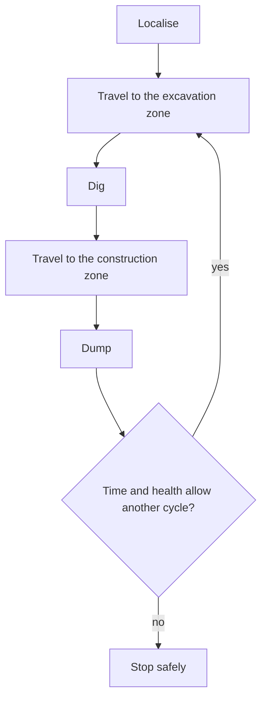

# Navigation and mission

Navigation turns a goal into a path and follows it. The mission decides which goal comes next, and it runs the dig and dump steps.

## Requirements

- Turn a goal into a path that avoids hazards, and follow that path.
- Replan when the picture around the rover changes.
- Start the dig sequence on arrival at the excavation zone. Start the dump sequence on arrival at the berm.
- Check that the rover is ready before an attempt. Stop the attempt if it is not.
- Retry a failed step a limited number of times. Then end the attempt safely.
- Keep the rover inside the arena without using the walls as landmarks.

## Inputs and outputs

Navigation takes hazards from [Perception](perception.md) and the pose from [Localisation](localisation.md). It sends velocity commands on `/cmd_vel`, and mechanism commands to [Teleop and rover control](teleop-and-control.md). It reports progress as telemetry through [Comms](comms.md).

Navigation does not own hazard detection, global anchoring or mechanism control. Perception, localisation and the control subsystem own those. Clear boundaries let you test each part alone.

## Rules

- [Autonomy](../rules.md#autonomy): each task has a hands-free boundary, and the points depend on it.
- [Autonomy conditions](../rules.md#autonomy-conditions): for travel, a "point and traverse" approach is not allowed.
- [Autonomy penalties](../rules.md#autonomy-penalties): contact with a rock, or driving over a crater, costs points.
- [Hands-free rules](../rules.md#hands-free-rules): announce each attempt. Send no commands, orientation data or obstacle locations during it.
- [Navigation and sensing](../rules.md#navigation-and-sensing): no walls for mapping, navigation or collision avoidance.
- [During the run](../rules.md#during-the-run): stay inside the arena. Do not push obstacles or fill craters in the obstacle zone.

## Obstacles are random

The judges place rocks and craters at random before each round. Teams cannot record a route and replay it. The rules forbid a "point and traverse" approach for the same reason. The rover must find a route through the obstacles it detects in that run.

A planner works from a map of what the sensors have seen so far, and it replans as the map fills in. A costmap is a common form of this map. Each cell holds a cost for driving through it.

## Forward to dig, reverse to dump

The bucket ladder sits at the front of the rover. The dump bed empties at the rear. So the rover approaches the excavation zone forwards and approaches the berm in reverse. Reversing avoids turning on the spot in loose sand. The planner and the controller must follow paths in both directions. A planner that assumes forward motion cannot plan the reversing approach to the berm.

## The cycle

Each step reports what happened. The log shows why the mission continued, succeeded or stopped.

## Readiness checks

Before an attempt, the mission checks that the rover can do the job. It checks that odometry arrives, the transforms exist, the pose is certain enough, and each sensor publishes. A rover with a hidden fault fails in ways that look like planning bugs, and those failures take hours to trace. If a check fails, the mission does not start.

## Bounded recoveries

Things go wrong during a run. The rover gets stuck, a path is blocked, or a detection flickers. A recovery is an action that gets the rover out of such a state, such as backing up or turning on the spot. Recoveries need limits, in the number of tries and in time. Without limits, the rover can spend the whole run recovering. The mission ends an attempt that exceeds its limits, and it announces the failure, as the hands-free rules require.

## Where the hands-free boundary falls

Each autonomy task starts hands-free at a point that the rules set.

- Excavation: before the rover touches the sand. Lift the digging mechanism out of the sand before you take control again.
- Dump: before the rover enters the construction zone. You can cross the obstacle zone by remote control.
- Travel and both full autonomy tasks: in the start zone. You can drive only inside the start zone to localise.

After that point, nobody can tell the rover where to go. The mission must already know its goal, or work it out from its own sensors. A goal in the arena frame depends on the pose from [Localisation](localisation.md).

## Open questions

1. Does autonomous excavation need navigation, or does it need only the dig sequence?
2. Which planner and controller suit a skid-steer rover that drives forward to dig and reverses to dump?
3. How does the planner stay inside the arena without using the walls as landmarks?
4. Does the mission run as a state machine or a behaviour tree?
5. How many retries does each step get before the attempt is declared failed?
6. How does the operator start an attempt and follow its progress without sending the rover anything?

## Further reading

- [Jazzy launch tutorials](https://docs.ros.org/en/jazzy/Tutorials/Intermediate/Launch/Launch-Main.html)
- [Nav2, the common ROS 2 navigation framework](https://docs.nav2.org/)
- [Nav2 keepout zones tutorial](https://docs.nav2.org/jazzy/tutorials/general_tutorials/navigation2_with_keepout_filter/navigation2_with_keepout_filter/)
