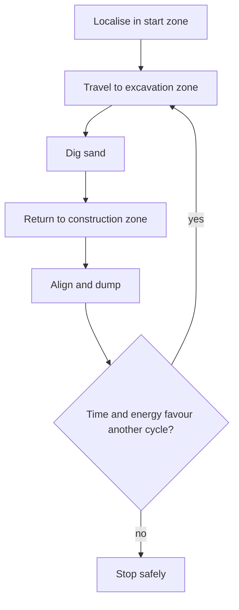

# Navigation and mission

Knowing where the rover sits and where obstacles lie does not move the wheels on its own. Navigation converts a target zone into a collision-free path around hazards and follows it with `/cmd_vel` commands, while the mission layer sequences the excavation cycle, coordinates automated digging and dumping, and stops cleanly when time runs short or a step fails.

Keeping hazard detection in [Perception](perception.md), pose estimation in [Localisation](localisation.md) and motor watchdogs in [Teleop and rover control](teleop-and-control.md) allows route planning and mission logic to be tested independently in [`innex_sim`](../../src/innex_sim/README.md).

## Costmap inflation

Judges place boulders and craters at random before every round, and the rules forbid pre-programmed "point and traverse" paths. Navigation therefore plans on a live **costmap**: a 2D grid over the arena floor where each cell stores the cost of placing `base_link` on that square.

If a planner treated `base_link` as a zero-width point and routed 5 cm past a boulder cell, INNEX-1's 0.675 m track width and 1.21 m length would drive all three side wheels straight over the rock for a 30-point penalty. Costmaps prevent body collisions through **inflation**, surrounding every lethal obstacle cell with outward rings of decreasing cost:

```text
  .   .  10  40  99 [XX] 99  40  10   .   .
                     ^^
               lethal boulder cell (XX)
          inscribed no-go ring (99) + buffer (40, 10)
```

Any cell closer than the rover's inscribed half-width (~0.34 m) receives an impassable cost (`99`), preventing the chassis from touching the rock at any heading. Cells slightly farther out receive a gradually decreasing buffer cost (`40`, `10`) that guides routes through open lanes where space allows, while still permitting footprint-checked paths through narrow gaps. As the rover moves forward and uncovers a crater behind a boulder, perception updates the `[XX]` cells and the planner recalculates the lowest-cost route.

## Driving directions

INNEX-1 is asymmetric front to back: the bucket ladder extends 15 cm ahead of the front chassis, while the dump chute empties from the lower rear. The rover therefore enters the excavation zone forwards to dig, and approaches the berm target area (1.5 m × 0.9 m) backwards to dump.

That layout creates an important trajectory trade-off on the return crossing. Turning 180 degrees on the spot twice per cycle drags the front and rear tyres sideways across loose sand, increasing energy consumption (which sits in the scoring denominator) and adding wheel-odometry slip. Driving forwards to excavate and reversing across the obstacle zone to the berm removes both spot turns, provided the planner (such as Nav2's `SmacPlannerHybrid` with Reeds-Shepp curves) and controller generate smooth forward and reverse paths using the rear OAK-D Pro camera for obstacle detection.

## Mission cycle

The mission executive steps through the excavation cycle shown in the diagram, publishing its active stage and transition reason over read-only telemetry to Foxglove.



Notice the decision step at the bottom of the loop. Under the provisional 4 November organiser clarification, the time `T` in both berm scoring formulas (`4.4 * V / (T * m)` and `1.5 * V / (T * E)`) is the actual run duration when the team ends the run, and full autonomy (600 points) requires at least two complete cycles with a scoring berm. Because total energy `E` only increases over time, stopping cleanly after two fast cycles can score higher than continuing into a slow third pass.

## Readiness and recovery

Before starting any autonomous attempt, the mission node verifies system readiness: `/odom` and IMU messages are arriving at rate, the `map -> odom -> base_link` transform chain is up to date, pose covariance sits within threshold, and camera and LiDAR topics are active. Refusing to start when a check fails prevents missing transforms or silent sensor topics from masquerading as path-planning defects.

During a run, loose sand or transient sensor shadows can still stall progress when a wheel sinks or a narrow corridor appears blocked. A **recovery** is a short fallback action (clearing stale costmap cells, reversing 0.4 m along the entry path, or pausing for a fresh scan). Every recovery has strict limits on retry count and elapsed time. Without fixed limits, a stalled rover can spend the rest of the run digging a deeper rut and draining battery energy; reaching the retry or time limit stops all motors, reports a `failed` state on telemetry, and lets the operator announce failure to the judge before resuming manual control.

## Hands-free boundaries

Competition rules define the exact physical boundary where manual control must stop for each autonomy task:

- Excavation (75 points): announce hands-free before the bucket ladder touches the sand, and lift it completely clear of the sand before resuming manual control.
- Dump (50 points): cross the obstacle zone under remote control if desired, then announce hands-free before any part of the rover enters the construction zone.
- Travel (250 points) and both full-autonomy tasks (450 and 600 points): localise under remote control strictly inside the 2 m × 2 m start zone, then announce hands-free before leaving the start zone at the start of the run.

Beyond that boundary, mission control transmits zero commands, pose updates or obstacle edits; target coordinates come solely from the rover's beacon-anchored frame and onboard sensors.

## Rules and constraints

- Plan and follow collision-free routes live without pre-programmed "point and traverse" paths or hard-coded arena dimensions ([Autonomy conditions](../rules.md#autonomy-conditions), [Organiser clarifications](../rules.md#organiser-clarifications-provisional)).
- Avoid boulder contact and craters in the obstacle zone (-30 points per incident), stay clear of the pit walls, and never push obstacles in the obstacle zone ([Autonomy penalties](../rules.md#autonomy-penalties), [During the run](../rules.md#during-the-run)).
- Follow the judge announcement protocol strictly and send nothing to the rover during hands-free attempts ([Hands-free rules](../rules.md#hands-free-rules)).

## Further reading

- [Nav2 Jazzy documentation](https://docs.nav2.org/)
- [Nav2 Smac Planner](https://docs.nav2.org/configuration/packages/configuring-smac-planner.html) and [Regulated Pure Pursuit](https://docs.nav2.org/configuration/packages/configuring-regulated-pure-pursuit.html)
- [Nav2 keepout zones tutorial](https://docs.nav2.org/jazzy/tutorials/general_tutorials/navigation2_with_keepout_filter/navigation2_with_keepout_filter/)
- [Jazzy launch tutorials](https://docs.ros.org/en/jazzy/Tutorials/Intermediate/Launch/Launch-Main.html)
