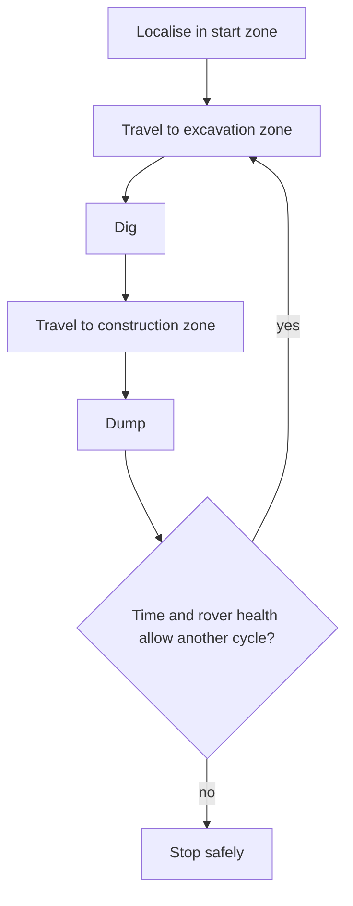

# Navigation and mission

Knowing where the rover sits and where the rocks lie doesn't move a single wheel on its own. Navigation turns a destination into a safe path around hazards and tracks that path with velocity commands, while the mission layer decides which step of the excavation cycle comes next and runs the dig and dump sequences.

Navigation and mission take hazards from [Perception](perception.md) and the pose from [Localisation](localisation.md). They output velocity commands on `/cmd_vel` and mechanism commands to [Teleop and rover control](teleop-and-control.md), and report live step status through [Comms](comms.md). Keeping hazard detection, localisation and low-level motor control outside this subsystem lets you test planning and mission logic in isolation before putting everything on the rover.

## Requirements

- Turn a target zone into a collision-free route around detected boulders, craters and walls, and follow it.
- Replan automatically whenever perception uncovers obstacles along the active route.
- Run the dig sequence upon arriving at the excavation zone and the dump sequence upon arriving at the berm.
- Check system readiness before starting any autonomous attempt, and refuse to start if a check fails.
- Report step state (`running`, `complete` or `failed`) and halt safely after bounded retries if a step gets stuck.
- Keep the rover inside the arena using live sensed walls without hard-coding the arena's dimensions.

## Competition rules

- [Autonomy](../rules.md#autonomy): each autonomous task has a defined hands-free boundary and point value; under the 4 November organiser email clarification, tasks score independently so a later failure doesn't erase earlier credit.
- [Autonomy conditions](../rules.md#autonomy-conditions): for travel autonomy, a pre-programmed "point and traverse" path is forbidden.
- [Autonomy penalties](../rules.md#autonomy-penalties): touching a boulder or driving over a crater in the obstacle zone costs 30 points per incident.
- [Hands-free rules](../rules.md#hands-free-rules): announce every attempt to the judge before starting, and send no commands, orientation data or obstacle locations while it runs.
- [Navigation and sensing](../rules.md#navigation-and-sensing) and [Organiser clarifications](../rules.md#organiser-clarifications-provisional): sensing and mapping the pit walls as obstacles is expected to be allowed in the final 2027 rulebook, while hard-coding arena dimensions is forbidden.
- [During the run](../rules.md#during-the-run): stay inside the arena without hitting the walls, and do not push boulders or fill craters in the obstacle zone.

## Why routes have to be planned live

Before each round, the judges scatter boulders and dig craters at random across the obstacle zone. Because the layout changes every run, recording a fixed waypoint path beforehand won't work, and the rules ban "point and traverse" approaches for the same reason.

Instead, navigation works from a live map built from what the rover's sensors have seen so far. The standard representation is a **costmap**: a 2D grid laid over the arena floor where every cell holds a numerical cost for driving across it. Flat, confirmed sand carries a low cost, cells close to a boulder carry an inflated buffer cost so the rover gives rocks wide clearance, and confirmed boulders, craters and sensed walls carry a lethal cost that no path can cross. As the rover drives forward and sees behind a rock for the first time, perception updates the costmap and the planner recalculates the cheapest safe route around whatever appeared.

## Forward to dig, reverse or turn to dump

INNEX-1 isn't symmetric front to back. The bucket ladder mounts on the front, while the dump bed empties out the rear. That means the rover must approach the excavation zone facing forwards, and line up with the berm target area facing backwards.

That creates an important planning choice: the rover can either reverse back across the obstacle zone to the berm, or drive forwards across the obstacle zone and turn 180 degrees near the construction zone. Reversing avoids dragging skid-steer tyres in a tight 180-degree spin on loose sand (which wastes power and kicks up wheel-odometry drift), but it requires a planner and controller that generate and follow reversing trajectories cleanly. Because obstacles can sit inside the construction zone as well as the obstacle zone, the dump approach still consults the live hazard map either way.

## The mission cycle

The mission layer steps through the excavation cycle shown in the diagram, logging why each stage started, succeeded or stopped.

Follow the decision box at the bottom of the loop. Under the 4 November email clarification, the berm scoring formulas divide by the actual duration of the run when the team ends it, and full autonomy requires two complete cycles. Stopping cleanly once two fast cycles finish, or ending early if a mechanism faults, can score higher than limping through a slow third cycle.

## Readiness checks

Before starting any autonomous attempt, the mission node runs a pre-flight check: odometry is arriving at rate, the `map` to `odom` to `base_link` transforms exist, pose uncertainty is below its threshold, and every required sensor topic is alive. Skipping these checks is a false shortcut. A missing transform or stale LiDAR topic produces bizarre steering failures that look like path-planning bugs and waste hours of test time to diagnose. If any readiness check fails, the mission refuses to arm and tells the operator why.

## Bounded recoveries

Real runs go wrong in messy ways: a wheel bogs down in soft sand, a noisy detection temporarily blocks the only lane, or a tight corridor stalls the controller. A **recovery** is a short fallback behaviour meant to unstick the rover, such as clearing stale costmap cells, backing up half a metre or turning in place to re-scan.

Recoveries need hard limits on both retry count and elapsed time. Without bounds, a stuck rover can burn the entire run rocking backwards and forwards in one crater. Once an attempt hits its retry or time cap, the mission stops the motors, reports a `failed` step state on telemetry and lets the operator announce the failure to the judge before taking manual control.

## Where the hands-free boundary falls

Each autonomy task starts hands-free at a specific line set by the rules:

- Excavation (75 points): go hands-free before the digging mechanism touches the sand, and lift it completely clear of the sand before taking control back.
- Dump (50 points): you can drive across the obstacle zone by remote control, then go hands-free before any part of the rover crosses into the construction zone.
- Travel (250 points) and both full autonomy tasks (450 and 600 points): you can drive by remote control only inside the start zone to localise against the beacon, then go hands-free inside the start zone.

After crossing that boundary, nobody in mission control can steer, send coordinates or update obstacle maps. The mission has to know its target zones from the beacon frame and its own sensors. Confirming whether zone offsets relative to the beacon count as allowed navigation goals (and not hard-coded arena dimensions) is an open question for the organisers.

## Open questions

1. Does autonomous excavation need route planning inside the excavation zone, or only the automated dig sequence once positioned?
2. Which planner and controller suit a skid-steer rover that drives forwards to dig and may reverse to dump?
3. Can the rover store zone goal offsets relative to the beacon frame without breaking the rule against hard-coded arena dimensions?
4. Does the mission run as a finite state machine or a behaviour tree?
5. How many retries and how many seconds does each step get before declaring failure?
6. How does the operator trigger a hands-free attempt cleanly and monitor its `running`, `complete` or `failed` state without sending commands during the attempt?

## Further reading

- [Jazzy launch tutorials](https://docs.ros.org/en/jazzy/Tutorials/Intermediate/Launch/Launch-Main.html)
- [Nav2, the ROS 2 navigation framework](https://docs.nav2.org/)
- [Nav2 keepout zones tutorial](https://docs.nav2.org/jazzy/tutorials/general_tutorials/navigation2_with_keepout_filter/navigation2_with_keepout_filter/)
