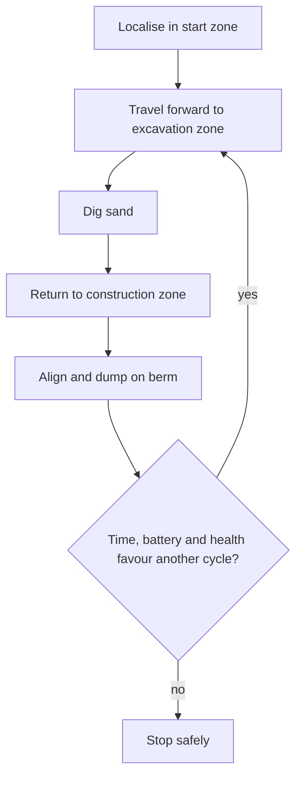

# Navigation and mission

Knowing where the rover sits and where the rocks lie does not turn a wheel on its own. Navigation converts a target zone into a collision-free trajectory around hazards and tracks it with `/cmd_vel` commands, while the mission layer sequences the excavation loop, runs automated dig and dump actions, and halts cleanly when time runs short or a step stalls.

Navigation and mission are planned for Stages 2 and 3 (automated digging and dumping in Stage 2; obstacle-zone traversal and full cycles in Stage 3) and have no package on `main`. Keeping hazard detection in [Perception](perception.md), pose estimation in [Localisation](localisation.md) and motor watchdogs in [Teleop and rover control](teleop-and-control.md) lets you test route planning and state machines against [`innex_sim`](../../src/innex_sim/README.md) before running on sand.

## Planning live on an inflated costmap

Judges rearrange boulders and craters at random before every round, and the rules ban pre-programmed "point and traverse" paths. Navigation therefore plans from a live **costmap**: a 2D grid laid across the arena floor where each cell stores the penalty for driving `base_link` onto that square.

Suppose a naive planner treated `base_link` as a zero-width dot and routed `5 cm` clear of a boulder cell. Because INNEX-1 spans `0.675 m` across its six wheels and `1.21 m` from rear bumper to bucket ladder, putting the centre of the rover `5 cm` from a rock drives all three side wheels straight over it for a `30`-point penalty.

Costmaps prevent footprint collisions through **inflation**, radiating decreasing penalty rings outward from every lethal obstacle cell:

```text
  .   .  10  40  99 [XX] 99  40  10   .   .
                     ^^
               lethal boulder cell (XX)
          inscribed no-go ring (99) + soft buffer (40, 10)
```

Look at the rings surrounding `[XX]`. Any cell closer than the rover's inscribed half-width (`~0.34 m`) carries an impassable cost (`99`), guaranteeing that the rover's body cannot touch the rock at any heading. Cells slightly farther out carry a decaying buffer cost (`40`, `10`) that nudges paths into wide open lanes whenever space permits, while still allowing slow, footprint-checked squeezing through narrow gaps. As the rover rolls forward and uncovers a crater hidden behind a boulder, perception marks the fresh `[XX]` cells and the planner recomputes the lowest-cost route on the fly.

## Forward to dig, reverse or turn to dump

INNEX-1 is asymmetric end to end: the bucket ladder overhangs the front chassis by `15 cm`, while the dump chute empties out the lower rear. The rover must therefore enter the excavation zone nose-first to dig, and back up to the red berm target area (`1.5 m x 0.9 m`) tail-first to dump.

That geometry creates a concrete trajectory choice on the return leg. Turning `180 degrees` on the spot twice per cycle forces six paddle tyres to scrub sideways through loose sand, burning battery energy (which sits in the scoring denominator) and amplifying wheel-odometry slip. Driving forwards to the excavation zone and reversing all the way back across the obstacle zone to the berm eliminates both spot turns, provided the planner (such as Nav2's `SmacPlannerHybrid` with Reeds-Shepp curves) and path controller generate smooth bidirectional paths using the rear OAK-D Pro camera for obstacle coverage.

## The mission cycle and when to stop

The mission node steps through the state loop in the next diagram, publishing its active stage and transition reason over read-only telemetry to Foxglove.



Pay close attention to the decision diamond at the bottom. Under the provisional 4 November 2026 organiser email, the time `T` in both berm formulas (`4.4 * V / (T * m)` and `1.5 * V / (T * E)`) equals the actual run duration when the team calls time, and full autonomy (`600` points) requires at least two complete cycles with a scoring berm. Because total energy `E` only ever rises over a run, ending cleanly right after two brisk, heavy cycles can outscore dragging through a slow, stalled third pass.

## Pre-flight readiness checks and bounded recoveries

Before entering any autonomous state, the mission node runs an automated readiness gate: `/odom` and IMU messages are arriving at rate, the `map -> odom -> base_link` transform chain is recent, pose covariance sits inside its threshold, and camera/LiDAR streams are alive. Refusing to start when a check fails saves hours of misdirected debugging, because a missing TF link or dead depth topic otherwise mimics a broken path planner.

Once running, sand and sensor noise still trigger stalls: a wheel bogs down, or a fleeting shadow blocks a narrow gap. A **recovery** is a short scripted fallback (clearing transient costmap cells, backing straight `0.4 m` along the entry track, or pausing for a clean scan). Every recovery carries strict caps on retry count and wall time. Without hard bounds, a bogged rover spends fifteen minutes churning a deeper trench and draining Wh; hitting the cap halts all actuators, latches a `failed` step status on telemetry, and lets the operator announce failure to the judge before taking manual control.

## Hands-free boundaries

Competition rules fix the exact physical line where manual driving must stop for each autonomy tier:

- Excavation (`75` points): announce hands-free before the bucket ladder touches the sand, and raise it completely clear of the sand before resuming teleop.
- Dump (`50` points): cross the obstacle zone under teleop if desired, then announce hands-free before any part of the rover crosses into the construction zone.
- Travel (`250` points) and both full-autonomy tiers (`450` and `600` points): localise by teleop strictly inside the `2 m x 2 m` start zone, then announce hands-free before leaving the start zone at the beginning of the run.

Beyond that line, mission control sends zero commands, poses or obstacle edits; every target coordinate must come from the rover's own beacon-anchored frame and live sensors.

## Requirements and competition rules

Subsystem requirements:

- Plan and track collision-free forward and reverse trajectories around boulders, craters and live sensed walls.
- Replan online as perception reveals previously occluded terrain.
- Coordinate the automated excavation and five-step dump sequences at their target zones.
- Enforce pre-flight readiness checks and bounded retries, halting safely and reporting `running`, `complete` or `failed` on telemetry.
- Stay inside the arena using live wall scans without hard-coding pit dimensions.

Applicable rules:

- [Autonomy](../rules.md#autonomy), [Autonomy conditions](../rules.md#autonomy-conditions) and [Autonomy penalties](../rules.md#autonomy-penalties): no "point and traverse" paths; `-30` points per boulder contact or crater crossing in the obstacle zone; independent task credit per the provisional 4 November email.
- [Hands-free rules](../rules.md#hands-free-rules): announce start and end to the judge with eye contact, and leave all laptops and controllers untouched mid-attempt.
- [Navigation and sensing](../rules.md#navigation-and-sensing) and [Organiser clarifications](../rules.md#organiser-clarifications-provisional): no hard-coded arena dimensions; live wall mapping provisionally expected to be allowed.
- [During the run](../rules.md#during-the-run): do not hit pit walls, and do not push boulders or fill craters inside the obstacle zone.

## Open questions

1. Which Nav2 planner/controller pair (`SmacPlannerHybrid` + `RegulatedPurePursuitController` or `MPPIController`) handles six-wheel skid-steer reversing onto the berm most cleanly?
2. Can the mission store excavation and berm goal offsets relative to the start-corner beacon without breaching the rule against hard-coded arena dimensions?
3. Does autonomous excavation (`75` points) drive forward slowly while digging, or hold chassis position while lowering the bucket ladder?
4. Does the mission executive stay a small Python state machine (`rclpy`) for Stage 2, or adopt `BehaviorTree.CPP` via Nav2 for Stage 3?
5. How does the operator arm an autonomous attempt right before taking hands off the laptop so the judge can verify zero packets leave mission control afterward?

## Further reading

- [Nav2 Jazzy documentation](https://docs.nav2.org/)
- [Nav2 Smac Planner](https://docs.nav2.org/configuration/packages/configuring-smac-planner.html) and [Regulated Pure Pursuit](https://docs.nav2.org/configuration/packages/configuring-regulated-pure-pursuit.html)
- [Nav2 keepout zones tutorial](https://docs.nav2.org/jazzy/tutorials/general_tutorials/navigation2_with_keepout_filter/navigation2_with_keepout_filter/)
- [Jazzy launch tutorials](https://docs.ros.org/en/jazzy/Tutorials/Intermediate/Launch/Launch-Main.html)
